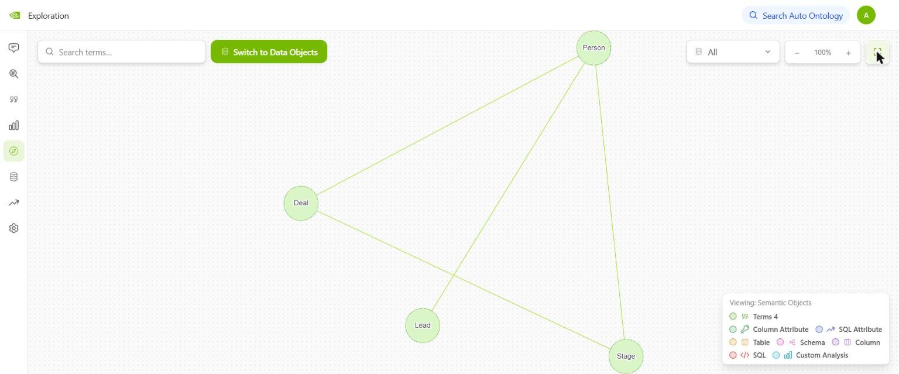
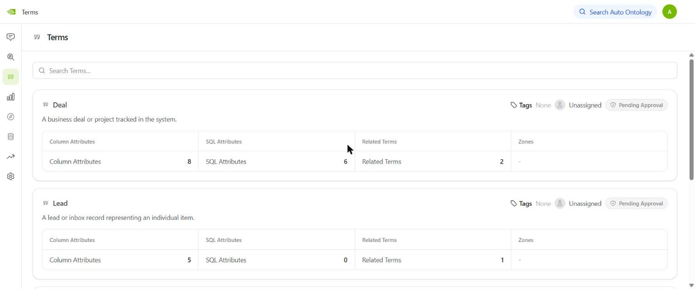
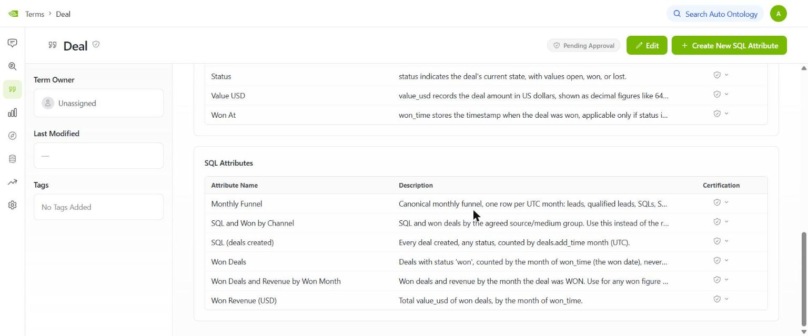
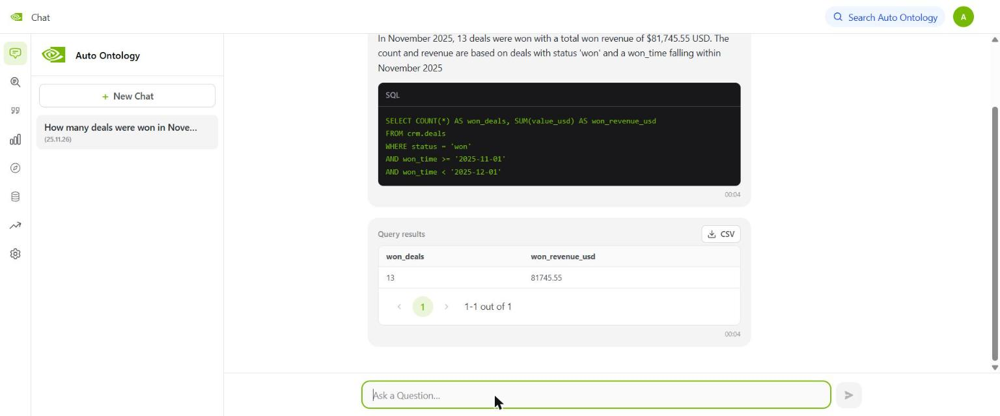

# A governed funnel layer for marketing and CRM, built with NVIDIA Auto Ontology

> **No client data in this repository.** This project came out of a pilot on a real CRM export from a B2B services company.
> Everything here (data, numbers, names, stages) is **synthetic** or generic. The client is not named.

Marketing teams usually get funnel numbers from pivot sheets and ad-hoc SQL. The same word ("leads") means different
things in different tabs, channel names are messy, and nobody can say which version is right.
This project tests whether an **ontology layer** (shared business definitions on top of the CRM data) can let people ask
questions in plain English and get answers that match the agreed definitions, with the SQL shown.

It uses [NVIDIA Auto Ontology](https://github.com/NVIDIA/auto-ontology) (open source, Apache-2.0), which builds the
ontology from database metadata and exposes it to AI agents through chat, MCP and an API.

## What I did

```
CRM export (Pipedrive-style)  ->  Postgres  ->  Auto Ontology  ->  chat / MCP / API
 persons, deals, leads, stages     crm.*         terms, links,       answers + the SQL used
                                                 10 funnel metrics
```

1. Loaded the CRM tables into Postgres (a spreadsheet stood in for a warehouse the client did not have yet).
2. Let Auto Ontology build the first draft automatically (terms, column descriptions, table links).
3. Added the **agreed funnel definitions** as SQL metrics (leads, qualified leads, SQLs, won deals, won revenue, channel view, a canonical monthly funnel).
4. Asked the same funnel question 8 times per setup and scored every answer against a known-correct result.

## What it looks like (synthetic demo)

Screenshots from a compile of the synthetic database only. No client data appears in them.

| Ontology graph | Terms and their metrics |
|---|---|
|  |  |

| The funnel metrics under the Deal term | A chat answer with its SQL |
|---|---|
|  |  |

The chat answer (13 deals won in one month, counted by won date) matched the same query run directly on the demo database.
That was a single check, not a repeat test; see the accuracy results below for how consistent answers were.

## Results of the accuracy tests

Same question every time ("for one month: how many leads, qualified leads, SQLs and won deals, and the won revenue?").
Scored by value against the client's own reference figures. 8 runs per batch is a small sample.

| Batch | Setup | Fully correct | Notes |
|---|---|---|---|
| B1 | Smaller default model, definitions in term descriptions | 3 of 8 | Counted won deals by creation month; once took leads from the wrong table |
| B2 | Same, plus one canonical monthly funnel query | 2 of 8 | Agent never used the canonical query; once returned SQL made only of typed-in numbers |
| B3 | Larger model (Nemotron Ultra) for answering | 4 of 8 | Leads, qualified, SQLs right every time; won-by-creation-month error in 4 runs |
| B4 | Larger model, plus a narrow "won deals by won month" metric | **6 of 8** | The creation-month error did not appear; two new, different errors did |

What the tests show:
- **Narrow, single-purpose metrics beat long descriptions.** The score improved when one metric stated exactly one way to compute one figure.
- **A bigger model removed the worst failures** (no answer, SQL with no table behind it) but not the wrong-date error.
- **It is not reliable enough to trust blindly.** Read the SQL under any funnel number, or certify the metrics and re-test.
- **It refuses honestly.** Asked for ad spend (not in the data), it said so instead of inventing a number.

## How this helps marketing

| Marketing need | What the ontology layer adds | Status in my tests |
|---|---|---|
| One definition of the funnel | Leads, qualified leads, SQLs and won deals defined once, in SQL, not in pivot helper columns | Definitions reproduced the client's reference numbers exactly when run directly |
| Channel reporting | Always group by an agreed source/medium group instead of raw lead source (blank, `google`, `google.com`, page URLs) | The agent used the agreed grouping once it was a metric |
| Self-serve questions | Marketers ask in plain English; answers come back in tens of seconds with the SQL | Works for simple questions; funnel questions need the checks above |
| Honest gaps | Missing data (for example ad spend, so no CAC or ROAS) is reported, not guessed | Observed |
| Fair conversion rates | Rates written as ratios of monthly totals can exceed 100%; a cohort view is fairer for campaigns | Documented as a caveat; cohort metric is a next step |

## How this helps CRM work

| CRM need | What the ontology layer adds |
|---|---|
| Ambiguous words | "Lead" meant a person in the funnel and an inbox record in the CRM. The ontology states which one and why |
| Dates | "Won" must use the won date, not the created date. A narrow metric enforces it |
| Data quality | Building the layer surfaces CRM issues: untagged traffic landing in "direct", a qualification flag that barely separates leads, won dates recorded late |
| Audit | Every answer returns its SQL and the steps taken, so a number can be traced |

## Honest limits

- Accuracy is not yet dependable; best result so far is 6 of 8 on one question.
- Nothing is certified (certification is the human review step) and I have not tested other questions at scale.
- Sampled column values and questions are sent to NVIDIA's hosted models. I dropped contact details before loading and you should review this before using real client data.
- Predictions through the optional Kumo integration were **not** tested.

## Fixing an incompatibility (patch included)

The hosted NVIDIA endpoint rejected the `guided_json` field that Auto Ontology's NVIDIA client sends, so the first compile
"succeeded" while skipping steps (9 failed model calls, thin ontology). `patches/auto-ontology-openai-client.patch` is a
small local change that uses the OpenAI-compatible client with tool calling instead. It is a diff of NVIDIA's code (Apache-2.0),
provided for reference, and may conflict with future upstream changes.

## Reproduce it on synthetic data

Needs Docker, [uv](https://docs.astral.sh/uv/) and an NVIDIA API key for the Auto Ontology step.

```bash
# 1. Auto Ontology itself (follow its README for .env), then apply the patch
git clone https://github.com/NVIDIA/auto-ontology.git
git -C auto-ontology apply ../patches/auto-ontology-openai-client.patch

# 2. Synthetic CRM data into Postgres (writes CSVs to data/synthetic and loads database showcase_demo)
export PGPASSWORD=<your postgres password>
uv run scripts/generate_synthetic_crm.py --csv-dir data/synthetic --load

# 3. Check the funnel SQL is consistent on that data
uv run scripts/verify_demo.py

# 4. Point Auto Ontology at showcase_demo (CONNECTION_STRINGS), compile, then add sql/funnel_metrics.sql
#    and sql/monthly_funnel.sql as SQL attributes under the Person and Deal terms
```

The synthetic data is random but seeded. It includes the quirks above on purpose: messy lead sources, deals won in a later
month than created, two meanings of "lead", almost everyone "Qualified", and no ad spend anywhere.
Percentages in the demo are illustrative of the generator, not of any real business.

## Repository layout

| Path | What it is |
|---|---|
| `scripts/generate_synthetic_crm.py` | Builds the synthetic CRM and loads Postgres |
| `scripts/verify_demo.py` | Runs the funnel SQL and checks totals add up |
| `sql/monthly_funnel.sql` | Canonical monthly funnel query |
| `sql/funnel_metrics.sql` | The single-purpose metrics |
| `data/synthetic/` | Generated CSVs (synthetic) |
| `patches/` | Local patch for Auto Ontology |
| `docs/test-log.md` | Test-by-test tables |
| `docs/images/` | Screenshots of the synthetic demo |

## Licence

My code, SQL, synthetic data and write-ups are under the [MIT licence](LICENSE).
The file in `patches/` is a diff of NVIDIA's Auto Ontology code and stays under NVIDIA's Apache-2.0 licence, not MIT.

## Credits

Built on [NVIDIA Auto Ontology](https://github.com/NVIDIA/auto-ontology) (Apache-2.0). Not affiliated with or endorsed by NVIDIA.
